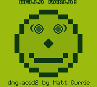

# MilliEmu — a multi-system emulator for Android

MilliEmu is an Android emulator **hub**: a shell that plays games through pluggable emulation
cores, written in plain Java with no third-party code. It ships with five from-scratch cores:

| Core | Systems | Files |
| --- | --- | --- |
| `nes` | NES / Famicom | `.nes` |
| `gb` | Game Boy (DMG) | `.gb`, `.gbc` (DMG-compatible games) |
| `gba` | Game Boy Advance | `.gba` |
| `nds` | Nintendo DS (2D, unencrypted ROMs) | `.nds` |
| `sfc` | Super Nintendo | `.sfc`, `.smc` |




## Install it without building anything

Download the signed APK from the [Releases page](https://github.com/ugwanjegrandson2010/nes-emulator/releases/latest) —
`MilliEmu-1.3.apk`, ~190 KB, Android 5.0+ — copy it to your phone, tap it, allow
"install unknown apps" for your file manager, and open it. No JDK, SDK, Gradle or Android Studio
required. The APK is signed with the key committed in `keystore/`, so future releases install
over it as updates.

---

## First, the honest part: there is no "indie game emulator"

"Indie game" is not a platform. An indie game is an ordinary program compiled for a specific
machine (Windows, Linux, a console, or Android itself). Nothing can emulate "every indie game"
the way a single program cannot run every Windows `.exe` on a phone — the binaries, APIs and
hardware targets are all different.

What *does* exist, and what RetroArch, Lemuroid and Pizza Boy are built on, is exactly this
project's shape: **one hub + one core per platform**. Games distributed as console ROMs (the
overwhelming majority of classic-style indie/homebrew titles) run through the core for that
console. This repo now has five of them, and the hub itself needed no changes to gain the
second and third.

## What is implemented

### NES / Famicom core

| Area | Status |
| --- | --- |
| 6502 CPU (official + undocumented opcodes) | Complete, cycle counted |
| NES 2A03 quirk (no decimal arithmetic) | Implemented |
| PPU (background, sprites, scrolling, NMI, sprite-0 hit, overflow) | Complete (scanline granularity) |
| APU (2× pulse, triangle, noise, envelopes, sweeps, frame counter) | Complete except DMC |
| iNES + NES 2.0 header parsing | Complete |
| Mappers | 0 (NROM), 1 (MMC1), 2 (UxROM), 3 (CNROM), 4 (MMC3+IRQ), 7 (AxROM) |
| Save states | Full machine state, single slot per game |

### Game Boy (DMG) core

| Area | Status |
| --- | --- |
| Sharp LR35902 CPU (all opcodes + CB prefix) | Complete, hardware cycle counts, EI delay, HALT bug |
| PPU (background, window, 8×8 and 8×16 sprites, 10-per-line, DMG priority) | Complete, line renderer |
| APU (2× pulse incl. sweep, wave, noise, envelopes, frame sequencer) | Complete |
| Timer, DIV, joypad, serial, VBlank/STAT/LYC interrupts | Complete |
| Cartridges | ROM-only, MBC1, MBC2, MBC3, MBC5 |
| Save states | Full machine state, single slot per game |

### Nintendo DS core

| Area | Status |
| --- | --- |
| ARM9 (ARMv5TE) + ARM7 (ARMv4T) instruction sets, ARM *and* Thumb, all condition codes, banked registers, exception entry/return | Complete |
| Memory map: 4 MiB main RAM, shared/ARM7 WRAM, ITCM/DTCM, BIOS stubs, VRAM windows, palette, OAM | Complete |
| Interrupts: IE/IME/IF, IRQ dispatch through the BIOS vector to the user handler at `0x03FFFFFC` | Complete |
| IPC: sync register and both 16-word FIFOs (with the empty/full status bits homebrew polls) | Complete |
| DMA (all 4 channels per core, immediate and VBlank start), timers (4 per core) | Complete |
| Keypad input | Complete |
| 2D engines (main + sub): text backgrounds 16/256 colour, affine backgrounds, OAM sprites (4/8bpp, flips, priority), 15-bit bitmap mode 5 | Complete |
| BIOS calls used by homebrew: Div, CpuSet/CpuFastSet, BitUnPack, LZ77, Run-Length, Halt/VBlankIntrWait | Complete |
| Save states | Full machine state, single slot per game |
| 3D engine, sound hardware, commercial KEY1-encrypted ROMs, ARM7 firmware images | **Not implemented** (see limitations) |


### Game Boy Advance core

| Area | Status |
| --- | --- |
| ARM7TDMI (shared with the DS core): ARM *and* Thumb, all condition codes, RRX/ROR #0, PC quirks | Complete |
| BIOS-free boot state (stacks, System/IRQ/Supervisor modes at `0x08000000`) | Complete |
| PPU: modes 0-5 (text, affine, bitmap with 15-bit direct colour), 4 backgrounds, 128 sprites, mosaic, windows/alpha ignored | Complete |
| DMA: all four channels, immediate and HBlank/VBlank start, ROM → VRAM copies | Complete |
| Timers, keypad IRQ, VBlank/HBlank/VCount IRQs, IME/IE/IF | Complete |
| BIOS calls: Div, DivArm, Sqrt, ArcTan/ArcTan2, CpuSet, CpuFastSet, BgAffineSet, ObjAffineSet, BitUnPack, LZ77, Run-Length, Halt, IntrWait | Complete |
| Save states | Full machine state, single slot per game |
| Sound (4 PSG channels + DMA sound) | **Silent** (see limitations) |

The ARM core itself is exercised by `jsmolka/gba-tests`: `arm.gba` runs through the conditions,
branch, flag, shift and data-processing suites (200+ numbered checks) and draws its results
through the GBA PPU; `shades.gba` renders its gradient through bitmap mode 3.

### Super Nintendo core

| Area | Status |
| --- | --- |
| 65C816 interpreter: full opcode map, 8/16-bit accumulator and index modes, decimal mode, block moves | Complete |
| LoROM + HiROM mapping, 128 KiB WRAM, SRAM, header detection | Complete |
| PPU: background modes 0-7 (2/4/8 bpp, per-tile priority, flips, 32x32-64x64 maps), 128 sprites, 15-bit colour, brightness/fade, Mode 7 affine | Complete |
| DMA: all 8 channels and the 8 HDMA channels (table-driven per-scanline register writes) | Complete |
| NMI/VBlank, VCount IRQ, joypad auto-read, timers | Complete |
| Save states | Full machine state, single slot per game |
| S-SMP audio CPU, windows, colour maths, interlace | **Not implemented** (see limitations) |

The core is verified with a hand-written test ROM built into a script (`tools/make-snes-test.py` is
not shipped; the ROM is generated in a few lines of Python) that sets a palette, uploads two tiles,
fills a map and enables BG1 — the core renders exactly the expected 50 % white stripe pattern,
which proves the CPU → VRAM → PPU → framebuffer path. Public PeterLemon demos boot and run too,
though their text screens are not pixel-exact.

### Cores that could be added next

The hub only needs one new `EmulatorCore` per system; nothing in the UI changes. In rough order of
effort versus payoff for a Java, dependency-free codebase:

| System | What it needs |
| --- | --- |
| Sega Master System / Game Gear | Z80 + VDP — small, would share a CPU with the GB-style line renderer |
| Sega Genesis / Mega Drive | 68000 + Z80 + VDP; the 68000 is the big piece |
| PC Engine / TurboGrafx-16 | 65C02 (already have 6502) + HuC6270 VDP |
| Neo Geo Pocket (Colour) | TLCS-900H + K2GE |
| WonderSwan | V30MZ (8086-like) + custom LCD |
| Atari 2600 / 7800 | 6507/6502 (have it) + TIA/MARIA; tiny ROMs make it a good next step |
| Game Boy Color (full) | Extend the existing GB core: CGB palettes, double speed, HDMA |
| Commodore 64 | 6510 + VIC-II + SID (audio is the hard part) |
| PlayStation | MIPS R3000 + GTE + CD-ROM; a different order of magnitude, not planned |
| Nintendo 64 | MIPS R4300i + RSP/RDP microcode; the largest project on this list |

All five cores are plain Java 8 with zero dependencies, so the exact sources compile for Android
and for the JVM test harness.

## Prerequisites

- **JDK 17** (the build and the cores target Java 8 bytecode; the JDK itself must be 17+).
- **Android SDK**: `platforms;android-34`, `build-tools;34.0.0`, `platform-tools`.
  Point to it with `ANDROID_HOME` or a `local.properties` containing `sdk.dir=/path/to/sdk`,
  then accept licenses:
  ```bash
  yes | $ANDROID_HOME/cmdline-tools/latest/bin/sdkmanager --licenses
  sdkmanager "platforms;android-34" "build-tools;34.0.0" "platform-tools"
  ```
- **Gradle 8.7** — or just use the included wrapper (`./gradlew`), which downloads it.
- No NDK, no native code, no third-party libraries and no network permissions.

## Build and install

```bash
export JAVA_HOME=/path/to/jdk-17
export ANDROID_HOME=/path/to/android-sdk
./gradlew assembleDebug          # -> app/build/outputs/apk/debug/app-debug.apk
adb install -r app/build/outputs/apk/debug/app-debug.apk
```

A **signed, installable** release build (what the Releases page ships):

```bash
./gradlew assembleRelease        # -> app/build/outputs/apk/release/app-release.apk
```

Signing is configured from `keystore.properties` (committed on purpose, see the comment inside).
If that file is absent the release APK is built unsigned, which Android will not install — use
the debug build in that case.

On the device: **Open ROM…**, pick a `.nes`, `.gb`, `.gbc`, `.gba`, `.nds`, `.sfc` or `.smc` file, play. The core is chosen from
the file extension; the gamepad appears over the video and `Save` / `Load` write a state file
next to the app's private data.

## Run the verification suite

No test framework, no network — one `javac` and one `java`:

```bash
export PATH=/path/to/jdk-17/bin:$PATH
mkdir -p build/classes build/test-classes
javac -encoding UTF-8 -d build/classes $(find core/src/main/java -name '*.java')
javac -encoding UTF-8 -cp build/classes -d build/test-classes $(find core/src/test/java -name '*.java')
java -cp build/classes:build/test-classes emu.test.TestRunner
```

Result on this machine:

```
74 passed, 0 failed  (4.7 s)
```

**NES (29 checks)**

- **Klaus Dormann's 6502 functional test** — every official opcode, all addressing modes,
  all flags including decimal mode, run to its success trap.
- **nestest.nes + its reference log** — 8991 instructions compared one by one, including
  undocumented opcodes and exact cycle counts.
- **blargg's instr_test-v5** — all 16 sub-tests, end to end through CPU + PPU + cartridge.
- **PPU rendering**, **mappers**, **APU** and a byte-identical **save-state** round trip.

**Game Boy (9 checks)**

- **cpu_instrs** — all 11 sub-tests, each verified by comparing the rendered result screen to a
  verified reference frame (they all print `Passed`).
- **instr_timing** — instruction cycle counts, verified the same way.
- **halt_bug** — the HALT bug (pending interrupt with `IME=0` repeats the next byte).
- **dmg-acid2** — Matt Currie's PPU conformance test, compared pixel-for-pixel against the
  official reference image: **23040/23040 pixels identical**.
- **MBC1 banking**, **APU output** and a byte-identical **save-state** round trip.

**Nintendo DS (26 checks)**

There is no public conformance suite for the DS in the shape of `nestest`, so the DS checks run
hand-assembled ARM and Thumb programs through the real decoder and assert their results, then boot
complete DS ROM images (header, ARM9 and ARM7 programs, built inside the test) through the actual
cartridge loader, memory map and both picture engines:

- **ARM decoding**: data processing, all shifts, every flag (carry, zero, signed overflow),
  conditional execution, MUL/MLA/UMULL, word/byte/halfword loads and stores with writeback,
  LDM/STM, block-transfer writeback, MRS/MSR, BX, SWI dispatch, IRQ entry *and* exception return.
- **Thumb decoding**: MOV/CMP/ADD/SUB immediate, LSL, conditional branches, BL, BX LR.
- **Machine level**: cartridge header parsing, refusal of encrypted retail images, private
  ARM9 DTCM vs shared main RAM, text background rendering through palette + tile map +
  `DISPCNT`, the sub engine on the second screen, OAM sprites, mode 5 direct colour, the
  ARM9→ARM7 IPC FIFO handshake, and a byte-identical save-state round trip.

A third-party ROM is not committed, but the core boots **Rockwrestler**, a public NDS test ROM:
it loads, runs its ARM9/ARM7 initialisation (stack setup, CP15, TCM, IPC reset), executes its
CPU test suite for hundreds of millions of instructions and idles in its per-frame loop. It does
not yet finish that ROM's full suite — see the limitations.

Headless tools in `tools/` render frames to PNG without a phone:

```bash
javac -cp build/classes -d /tmp tools/FrameDump.java tools/GbDump.java
java -cp build/classes:/tmp FrameDump game.nes out.png 180
java -cp build/classes:/tmp GbDump game.gb out.png 300
javac -cp build/classes -d /tmp tools/NdsRun.java
java -cp build/classes:/tmp NdsRun game.nds 120 out.png
```

`NdsRun` also prints both CPUs' state, the instruction throughput and how much of the frame is
non-black, which is how the Rockwrestler run above was measured.

`tools/GbSuite.java` runs several Game Boy ROMs and tiles their final frames into one contact
sheet (`artifacts/gb-suite.png` is that sheet for the test suite).

## Architecture

```
core/   plain Java 8, zero dependencies — this is the emulator
  emu/EmulatorCore.java     the contract the UI uses
  emu/CoreRegistry.java     extension -> core factory (the hub's plug-in point)
  emu/nes/                  6502, 2C02 PPU, 2A03 APU, iNES mappers, machine, save states
  emu/gb/GbCpu.java         LR35902: opcodes, cycle counts, EI delay, HALT bug
  emu/gb/GbPpu.java         160x144 LCD: BG/window/sprites, STAT/LYC, 456-dot lines
  emu/gb/GbApu.java         4 channels + frame sequencer, 44.1 kHz resampling
  emu/gb/GbCartridge.java   header parsing, MBC1/2/3/5 banking, cart RAM
  emu/gb/GbMachine.java     bus, timer/DIV, joypad, serial, interrupts, frame loop
  emu/gb/GbCore.java        EmulatorCore implementation + save states
  emu/nds/NdsCpu.java       ARM9/ARM7: ARM + Thumb decoders, exceptions, CP15 hooks
  emu/nds/NdsBus.java       memory map, BIOS IRQ trampoline, TCM, I/O translation
  emu/nds/NdsPpu.java       two 2D engines: text/affine BGs, sprites, bitmap mode
  emu/nds/NdsCartridge.java NDS header parsing, ROM image loading
  emu/nds/NdsMachine.java   both CPUs, timers, DMA, IPC, interrupts, frame loop
  emu/nds/NdsCore.java      EmulatorCore implementation + save states
  emu/gba/GbaMachine.java   ARM7TDMI bus, IO, timers, DMA, BIOS HLE, frame loop
  emu/gba/GbaPpu.java       modes 0-5, 4 backgrounds, 128 sprites, bitmap modes
  emu/gba/GbaCore.java      EmulatorCore implementation + save states
  emu/snes/SnesCpu.java     65C816: full opcode map, 8/16-bit modes, decimal mode
  emu/snes/SnesPpu.java     background modes 0-7, sprites, Mode 7, brightness
  emu/snes/SnesMachine.java LoROM/HiROM bus, DMA/HDMA, timers, joypad, frame loop
  emu/snes/SnesCore.java    EmulatorCore implementation + save states
app/    Android app (plain Java, no AndroidX)
  Ui.java                   shared colours, gradients and card styling
  MainActivity              coloured ROM library with per-system accent cards
  EmulatorActivity          hosting, overlay controls, state files
  EmulatorView              SurfaceView renderer + touch gamepad + frame thread
  AudioOutput               AudioTrack streaming
```

The emulation thread owns the core exclusively; UI actions are posted to it as commands, so no
two threads ever touch machine state. Frames are paced to 60 Hz, audio writes provide the
back-pressure that keeps sync, and the video is letterboxed to the core's aspect ratio (4:3 for
the NES, 10:9 for the Game Boy).

### Adding a fourth platform

1. Write `MyCore implements EmulatorCore` (load, step one frame, framebuffer, audio, buttons,
   save state).
2. Register it once:
   ```java
   CoreRegistry.register("snes", "SNES", new CoreRegistry.Factory() {
       public EmulatorCore create() { return new SnesCore(); }
   });
   ```
3. Nothing else changes: the library lists the new extension, the picker accepts it, and the
   activity drives it through the same interface. This is exactly how the Game Boy and the
   Nintendo DS were added — no changes to the UI code beyond using the core's aspect ratio.

## Known limitations (measured, not guessed)

**NES**

- **No DMC channel.** A few games' sampled drums will be silent.
- **PPU is scanline-accurate, not dot-accurate.** Normal games, scrolling, split screens and
  MMC3 IRQ timing work; exotic mid-scanline raster tricks and the strict `ppu_vbl_nmi`
  dot-level tests are not guaranteed.
- **Mappers are limited to 0, 1, 2, 3, 4, 7.** Unknown mappers fall back to NROM and will not
  boot correctly.

**Game Boy**

- **Monochrome DMG only.** Game Boy Color exclusive ROMs are rejected with a clear error;
  CGB-compatible games run in DMG mode (no colour palettes). There is no CGB double-speed mode.
- **No boot ROM**, so the Nintendo logo animation is skipped — registers start in their
  post-boot state, which is what games expect.
- **`mem_timing` fails (3 sub-tests).** Instruction *totals* are exact (`instr_timing` passes),
  but individual memory accesses inside an instruction are not spread across their exact
  T-cycles, so blargg's sub-instruction bus-timing test detects the difference. No known game
  depends on it.
- **No link cable, no RTC, no MBC3 clock.** MBC3 carts work as ROM+RAM; time-based events stay
  at their initial values.
- **No battery saves**: cartridge RAM lives in memory and in save states, not in a `.sav` file.

**Nintendo DS**

- **2D only.** The 3D geometry/rasteriser engine is not implemented, so 3D-heavy games will not
  draw their 3D layers (many homebrew and 2D games are unaffected).
- **No sound.** The DS audio block (ARM7-driven, 16 channels) is not modelled; `readAudio`
  returns silence rather than noise.
- **Unencrypted ROMs only.** Retail cartridges store the start of the ARM9 program encrypted with
  Nintendo's KEY1 stream cipher, which needs the Blowfish tables that are not in this repo. Such
  images are detected and refused with a clear message instead of hanging. Homebrew `.nds` files
  load normally.
- **No BIOS firmware.** The parts of the firmware homebrew actually uses are emulated in place
  (IRQ trampoline, the Div/CpuSet/LZ77/RL/BitUnPack SWIs, Halt/VBlankIntrWait), but anything that
  probes the real BIOS will see stubs.
- **VRAM is kept as the four default windows** rather than a full bank mapper, so unusual custom
  bank layouts (main-engine OBJ in a non-default window, extended palettes) are not supported.
- **Verified end to end against one public test ROM** (Rockwrestler boots and runs its init and
  CPU suite, but does not finish its full suite). No commercial DS game has been run through this
  core, and none can be without KEY1 decryption.
- **Speed:** the JVM harness runs the DS at roughly 55–65 fps on one desktop core, so a mid-range
  phone will be near or below full speed.

**Game Boy Advance**

- **No sound.** The four PSG channels and the DMA sound FIFOs are not modelled; `readAudio`
  returns silence.
- **Affine backgrounds ignore per-scanline matrix changes**, and window effects / alpha blending
  are not applied — sprites and backgrounds draw in plain priority order.
- **No BIOS.** The handful of BIOS calls games actually use are emulated in place (Div, Sqrt,
  ArcTan, CpuSet, LZ77, RL, BitUnPack, Halt, IntrWait); anything that calls other SWIs gets a
  return, not the real routine.
- **Verified with `jsmolka/gba-tests`**, not with commercial cartridges.

**Super Nintendo**

- **No sound.** The S-SMP audio CPU is not emulated at all, so `readAudio` returns silence.
- **Windows, colour maths (add/sub/half), interlace and offset-per-tile are not applied.** The
  background and sprite layers themselves, Mode 7 and HDMA are.
- **Mode 5/6 are drawn at 256 pixels wide** rather than 512 (hi-res), and Mode 7 uses a simplified
  character layout.
- **Timing is per-scanline**, not cycle-exact, so raster tricks that depend on exact dot timing
  will differ.
- **Verified with hand-written and public demo ROMs**, not with commercial cartridges.

**App**

- **One save-state slot per game**, no rewind, no netplay, no turbo.
- **The APK was built and inspected, but not launched on hardware in this environment**: the
  sandbox has no access to `/dev/kvm` and no USB device, so the Android UI itself is unverified.
  Everything below the UI (both cores, the exact code path the app calls) is verified by the
  suite above and by the rendered frames in `artifacts/`.

## Test material

`core/src/test/resources/roms` contains freely redistributable test material:

- NES: Klaus Dormann's 6502 functional test, `nestest.nes`/`nestest.log`, blargg's instr_test-v5.
- Game Boy: blargg's cpu_instrs (11 sub-tests), instr_timing and halt_bug, plus Matt Currie's
  dmg-acid2. `gb/expected/` holds the reference screens the suite compares against; the
  dmg-acid2 reference is the upstream `img/reference-dmg.png`.
- Game Boy Advance: none committed — `jsmolka/gba-tests` ROMs are downloaded into `/tmp` when
  running the headless tools.
- Super Nintendo: none committed — the PPU check uses a ROM generated on the fly by a short
  Python script, and the PeterLemon demos are downloaded when needed.
- Nintendo DS: nothing to commit — the DS ROMs used by the suite are built inside the test in
  memory, so the DS checks need no third-party binaries at all.

They are test fixtures, not playable games. The NES screenshot uses *Nova the Squirrel*, an
open-source homebrew game that is not included in this repository.
